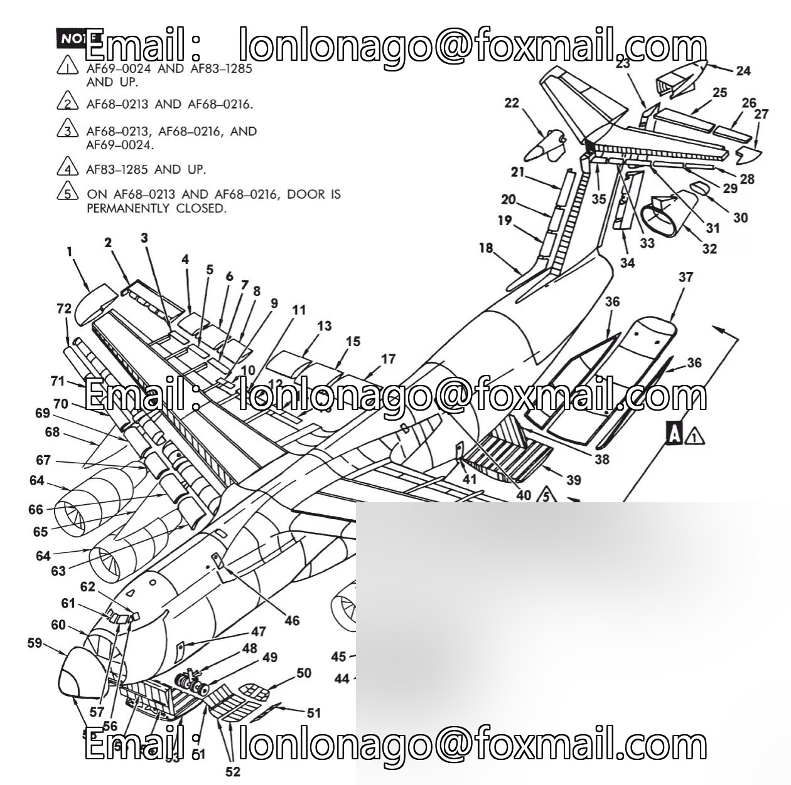
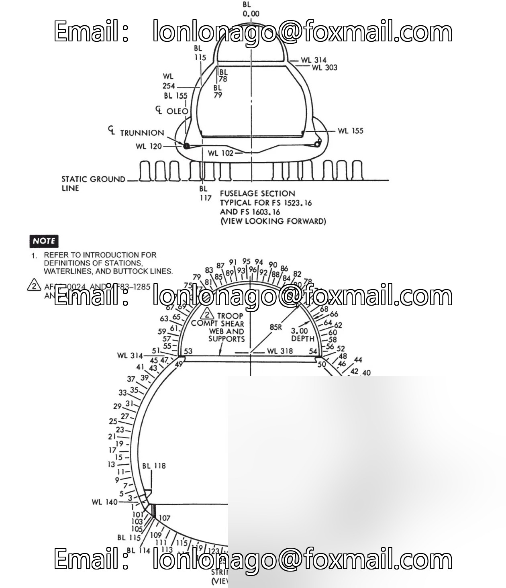
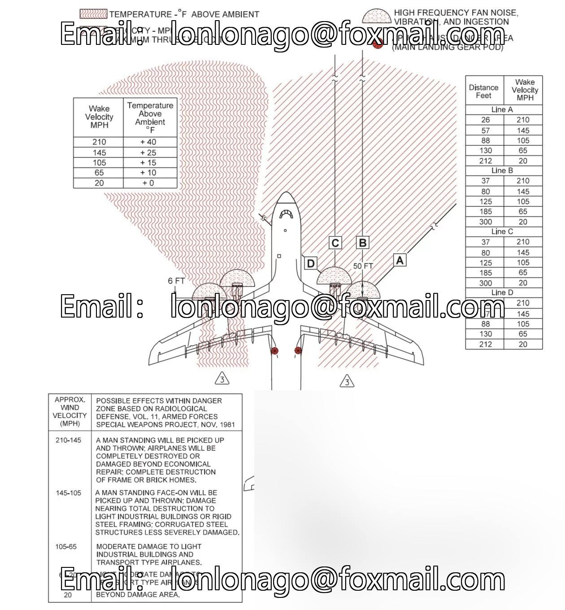

# USAF (Aviation and Space Force) addresses ground maintenance and maintenance technology for the C-5M transport aircraft.

## Body

The U.S. Air Force (USAF) supplementary technical documents for ground support and maintenance of the C-5M transport aircraft, PDF , 100 pages, covering ground operations, maintenance processes, and precautions of the C-5M transport aircraft, suitable for research and reference for military enthusiasts and aviation technology.
refunded upon sale.

This is a supplementary document from the U.S. Air Force for C-5M transport aircraft covering ground operation, maintenance procedures and precautions; the pdf contains 100 pages on ground operations, maintenance processes and notes, suitable for military enthusiasts and aviation technical research, with a no-return policy.

<!-- AI_ENRICHED -->

## Images

## Payment

Here is a pay link on Stripe ( https://buy.stripe.com/3cs8yP7sY87d0vu9AB ). Please contact me lonlonago@foxmail.com after funding $89, and I will send you a complete data files , thank you!

